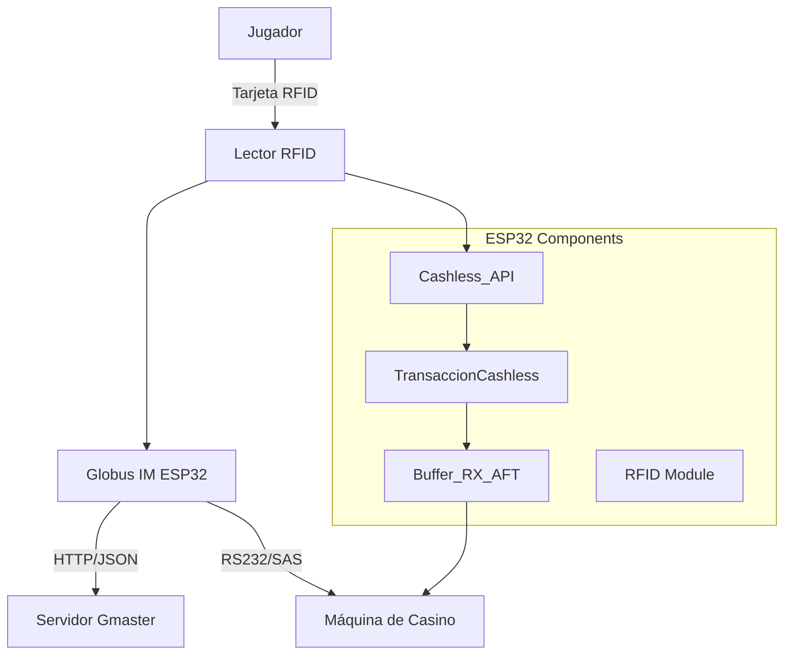
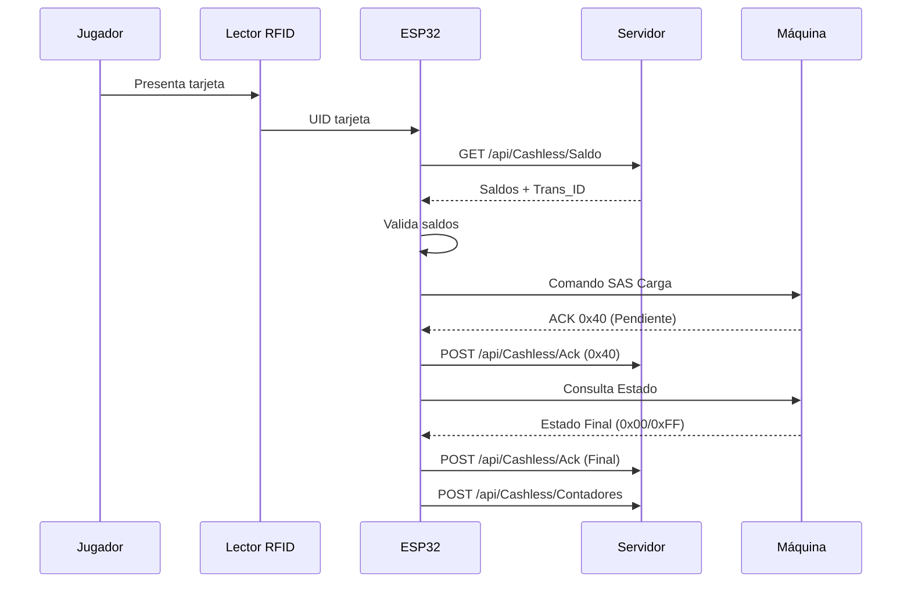
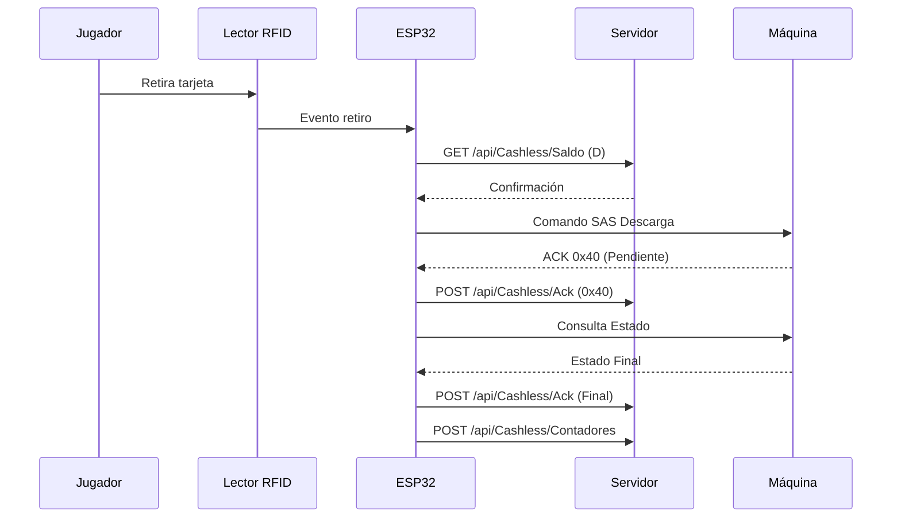
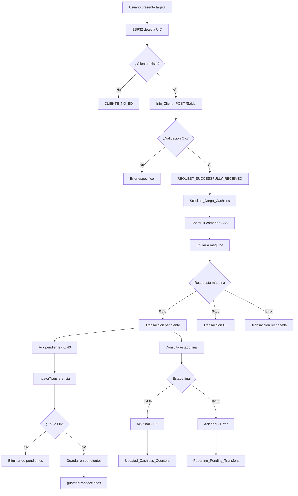
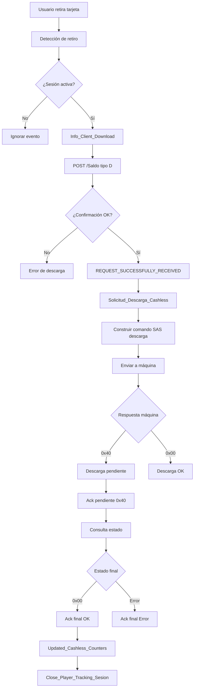
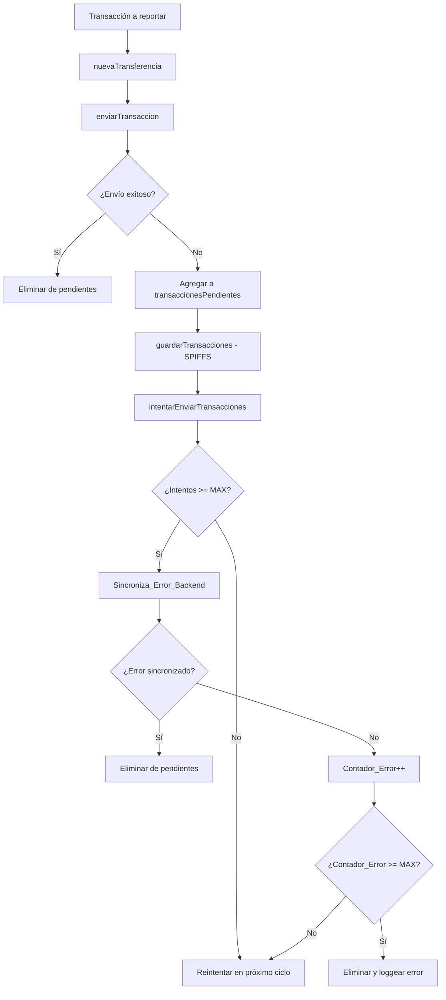
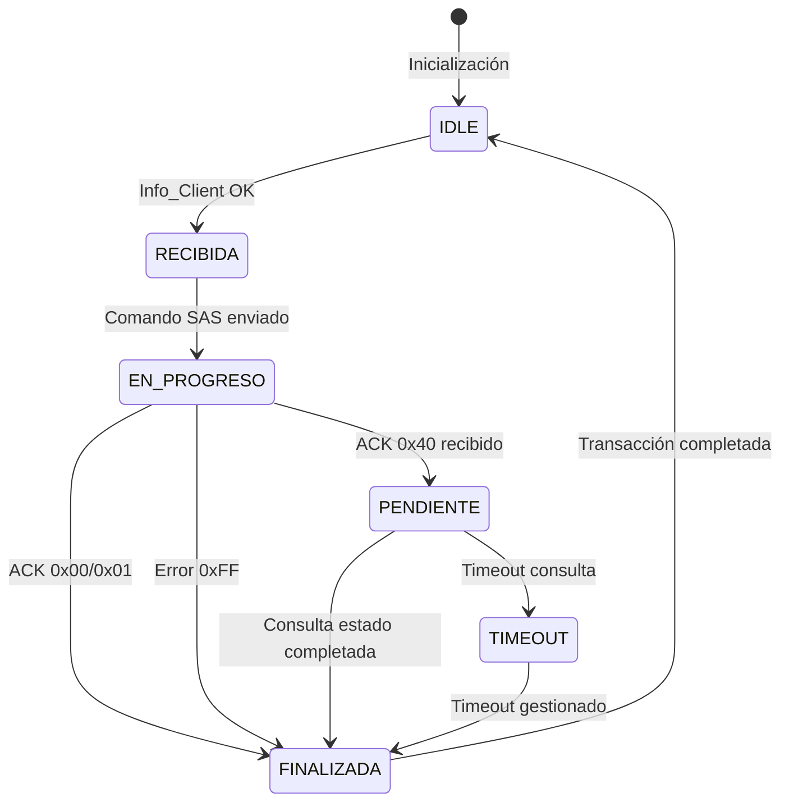
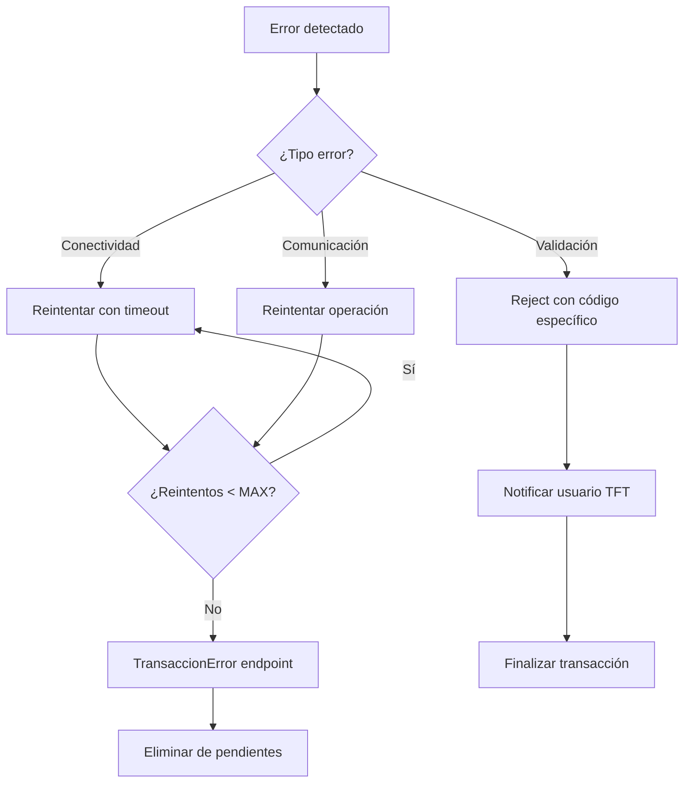

# DOCUMENTACIÓN TÉCNICA DEL MÓDULO CASHLESS
## GLOBUS IM ESP32

**Fecha de creación:** 2026-08-19  
**Versión firmware:** 2.0  
**Estado:** Documentación inicial basada en código fuente real

---

# TABLA DE CONTENIDO

1. [Arquitectura General](#1-arquitectura-general)
2. [Componentes del Módulo](#2-componentes-del-módulo)
3. [API REST Endpoints](#3-api-rest-endpoints)
4. [Flujo de Carga Cashless](#4-flujo-de-carga-cashless)
5. [Flujo de Descarga Cashless](#5-flujo-de-descarga-cashless)
6. [Sistema de Reintentos y Transacciones Pendientes](#6-sistema-de-reintentos-y-transacciones-pendientes)
7. [Protocolo SAS y Comunicación RS232](#7-protocolo-sas-y-comunicación-rs232)
8. [Contadores Cashless](#8-contadores-cashless)
9. [Máquina de Estados](#9-máquina-de-estados)
10. [FreeRTOS y Concurrencia](#10-freertos-y-concurrencia)
11. [Manejo de Errores](#11-manejo-de-errores)
12. [Trazabilidad de Transacciones](#12-trazabilidad-de-transacciones)
13. [Riesgos Técnicos Conocidos](#13-riesgos-técnicos-conocidos)
14. [Historial de Cambios](#14-historial-de-cambios)

---

# 1. ARQUITECTURA GENERAL

## 1.1 Diagrama de Arquitectura



## 1.2 Flujo de Datos - Carga



## 1.3 Flujo de Datos - Descarga



---

# 2. COMPONENTES DEL MÓDULO

## 2.1 Clases Principales

| Clase | Archivo | Responsabilidad |
|-------|---------|-----------------|
| `Cashless_API` | `include/RFID.h`, `src/RFID.cpp` | Coordinación de operaciones Cashless, comunicación HTTP |
| `TransaccionCashless` | `include/Buffer_Cashless.h`, `src/Cashless.cpp` | Gestión de estados de transacción, control de timeouts |
| `Buffer_RX_AFT` | `include/Buffer_Cashless.h`, `src/Buffers_Cashless.cpp` | Buffers de comunicación con máquina SAS |
| `Cashless` | `include/Cashless.h`, `src/Cashless.cpp` | Operaciones de transacción AFT/EFT, gestión de Trans_ID |
| `Fidelizacion` | `include/RFID.h`, `src/RFID.cpp` | Gestión de sesiones de jugador |

## 2.2 Variables Globales Cashless

| Variable | Tipo | Ubicación | Descripción |
|----------|------|-----------|-------------|
| `Objeto_Transfer` | `DynamicJsonDocument` | `src/RFID.cpp:221` | JSON temporal para ACK de carga |
| `Objeto_Transfer_Download` | `DynamicJsonDocument` | `src/RFID.cpp:222` | JSON temporal para ACK de descarga |
| `transaccionesPendientes` | `std::vector<String>` | `include/Comunicaciones.h:157` | Cola de transacciones por enviar |
| `Intentos_Envio_Ack_Transfer` | `uint8_t` | `src/RFID.cpp:130` | Contador de reintentos |
| `CodeHttp` | `int` | `src/RFID.cpp:129` | Código de respuesta HTTP |
| `transaccionesFile` | `const char*` | `src/RFID.cpp:112` | Path: "/transacciones.txt" |

## 2.3 Constantes y Defines

| Constante | Valor | Descripción |
|-----------|-------|-------------|
| `LOAD_TRANSACTION` | `"C"` | Tipo de transacción de carga |
| `DOWNLOAD_TRANSACTION` | `"D"` | Tipo de transacción de descarga |
| `MAX_INTENTOS_ENVIO_ACK_TRANSFER` | `2` | Máximo de reintentos de ACK |
| `REQUEST_SUCCESSFULLY_RECEIVED` | `0x29` | Solicitud recibida correctamente |
| `INSUFFICIENT_BALANCE` | `0x23` | Saldo insuficiente (C,R,NR en 0) |
| `TRANSFER_PENDING` | `0x51` | Código de evento SAS pendiente |
| `TIMEOUT_ACK_TRANSACCION` | `20000` | 20 segundos timeout ACK |
| `TIMEOUT_EVENT_TRANSACCION` | `10000` | 10 segundos timeout evento |
| `TIMEOUT_RESULT_TRANSACCION` | `10000` | 10 segundos timeout resultado |

---

# 3. API REST ENDPOINTS

## 3.1 Tabla de Endpoints

| Endpoint | Método | Propósito | Request | Response | Momento |
|----------|--------|-----------|---------|----------|---------|
| `/api/Cashless/Saldo` | POST | Consultar saldo del cliente | Cliente_ID, Trans_Tipo, Trans_ID, etc. | Saldos, Trans_ID, Cliente_Nombre | Inicio de sesión |
| `/api/Cashless/Ack` | POST | Reportar estado de transacción | Objeto_Transfer completo | IsSuccess, Message | Pendiente (0x40) y Final |
| `/api/Cashless/Contadores` | POST | Actualizar contadores Cashless | Entradas/Salidas por tipo | IsSuccess, Message | Post-transacción exitosa |
| `/api/Cashless/TransaccionError` | POST | Reportar error de transacción | Objeto_Transfer completo | IsSuccess, Message | Máximo de reintentos |

**Puerto servidor:** 9595 (configuración actual)

## 3.2 `/api/Cashless/Saldo` - Consulta de Saldo

**Ubicación:** `src/RFID.cpp:6202-6497`

### Request

```json
{
  "IsSuccess": true,
  "Cliente_ID": 12345,
  "Trans_Tipo": "C",
  "Fecha_Hora": "2026-08-19 10:30:45",
  "Trans_ID": 123456,
  "Ip": "192.168.1.100",
  "MAC": "AA:BB:CC:DD:EE:FF",
  "Id_Maquina": 0,
  "Key": "AFT-Registration-Key",
  "Creditos_Actuales": 100,
  "Tipo_Maq": "AFT"
}
```

### Response

```json
{
  "IsSuccess": true,
  "Cliente_ID": 12345,
  "Trans_Tipo": "C",
  "Saldo_Canjeable": 50000,
  "Saldo_Restringido": 10000,
  "Saldo_No_Restringido": 20000,
  "Trans_ID": 123456,
  "Fecha_Hora": "2026-08-19 10:30:46",
  "Message": "Saldo obtenido correctamente",
  "Cliente_Nombre": "Juan Pérez",
  "Cashless_Estado": "Habilitado",
  "Ip": "192.168.1.100",
  "Key": "AFT-Registration-Key",
  "MAC": "AA:BB:CC:DD:EE:FF",
  "Trans_Estado": "0x00",
  "Tipo_Maq": "AFT",
  "InformacionPuntosPantalla": {
    "Cliente_Nombre": "Juan Pérez",
    "Casino": "Casino Central",
    "Deno_Cashless": 1.0,
    "Total_Fide": 5000.0,
    "Total_Bole": 1000.0,
    "Nivel_Usuario": "Oro",
    "Actual_Fide": 500.0,
    "Actual_Bole": 100.0
  }
}
```

### Validaciones

El método `Info_Client()` valida:

1. **WiFi Conectado** → `NOT_WIFI_CONNECTION (0x35)` si falso
2. **Tipo de Máquina coincide** → `TYPE_MACHINE_NOT_MACTH (0x36)` si no coincide
3. **Comunicación con máquina** → `NOT_COMMUNICATION_WITH_THE_MACHINE (0x34)` si falla
4. **Cliente ID coincide** → `CLIENT_NOT_MACTH (0x26)` si diferente
5. **Tipo de transacción coincide** → `TYPE_TRANS_NOT_MACTH (0x28)` si diferente
6. **Trans_ID coincide** → `TRANS_ID_NO_MACTH (0x24)` si diferente
7. **Saldos son enteros válidos** → `INVALID_BALANCE (0x27)` si inválidos
8. **Saldos no todos cero** → `INSUFFICIENT_BALANCE (0x23)` si todos cero

### Headers

```cpp
https.addHeader("Content-Type", "application/json");
https.addHeader("hash", Info_Cashless.Get_Hash_Valido());
https.addHeader("gmsec", "GMaster");
https.addHeader("Authorization", "Bearer " + Info_Cashless.Get_Token_Valido());
```

## 3.3 `/api/Cashless/Ack` - Reporte de Estado

**Ubicación:** `src/RFID.cpp:7635-7743`

### Request (Estado Pendiente 0x40)

```json
{
  "IsSuccess": false,
  "Cliente_ID": 12345,
  "Trans_Tipo": "C",
  "Saldo_Canjeable": 50000,
  "Saldo_Restringido": 10000,
  "Saldo_No_Restringido": 20000,
  "Trans_ID": 123456,
  "Fecha_Hora": "2026-08-19 10:30:50",
  "Message": "Transacción pendiente",
  "Cliente_Nombre": "Juan Pérez",
  "Cashless_Estado": "Pendiente",
  "Ip": "192.168.1.100",
  "Key": "AFT-Registration-Key",
  "MAC": "AA:BB:CC:DD:EE:FF",
  "Trans_Estado": "0x40",
  "Tipo_Maq": "AFT",
  "Cashless_ID": 789
}
```

### Request (Estado Final)

```json
{
  "IsSuccess": true,
  "Cliente_ID": 12345,
  "Trans_Tipo": "C",
  "Saldo_Canjeable": 50000,
  "Saldo_Restringido": 10000,
  "Saldo_No_Restringido": 20000,
  "Trans_ID": 123456,
  "Fecha_Hora": "2026-08-19 10:31:00",
  "Message": "Transacción completada",
  "Cliente_Nombre": "Juan Pérez",
  "Cashless_Estado": "Completado",
  "Ip": "192.168.1.100",
  "Key": "AFT-Registration-Key",
  "MAC": "AA:BB:CC:DD:EE:FF",
  "Trans_Estado": "0x00",
  "Tipo_Maq": "AFT",
  "Cashless_ID": 789
}
```

### Response

```json
{
  "IsSuccess": true,
  "Message": "ACK recibido correctamente"
}
```

## 3.4 `/api/Cashless/Contadores` - Actualización de Contadores

**Ubicación:** `src/RFID.cpp:8490-8610`

### Request

```json
{
  "IsSuccess": true,
  "Entrada_Canjeable": "50000",
  "Entrada_Restringida": "10000",
  "Entrada_No_Restringida": "20000",
  "Salida_Canjeable": "0",
  "Salida_Restringida": "0",
  "Salida_No_Restringida": "0",
  "Ip": "192.168.1.100",
  "MAC": "AA:BB:CC:DD:EE:FF",
  "Id_Maquina": 0,
  "Fecha_Hora": "2026-08-19 10:31:05",
  "Key": "AFT-Registration-Key",
  "Tipo_Maq": "AFT"
}
```

### Response

```json
{
  "IsSuccess": true,
  "Message": "Contadores actualizados"
}
```

## 3.5 `/api/Cashless/TransaccionError` - Reporte de Error

**Ubicación:** `src/RFID.cpp:7746-7830`

Este endpoint se utiliza cuando se alcanza el máximo de intentos de envío de ACK.

### Request

Mismo formato que `/api/Cashless/Ack`, con el estado de error correspondiente.

### Response

```json
{
  "IsSuccess": true,
  "Message": "Error registrado correctamente"
}
```

---

# 4. FLUJO DE CARGA CASHLESS

## 4.1 Diagrama de Flujo Completo



## 4.2 Inicio de Sesión y Consulta de Saldo

**Función:** `Cashless_API::Info_Client()` (`src/RFID.cpp:6202`)

### Pasos:

1. **Detección de tarjeta** → Task `Read_RFID` detecta UID
2. **Obtener Cliente_ID** → `contadores.Get_Client_ID_Transaccion_Int()`
3. **Construir request JSON** con:
   - Cliente_ID
   - Trans_Tipo = "C" (carga)
   - Trans_ID (generado por `Cashless.Get_Trans_ID_Int()`)
   - Fecha_Hora actual
   - Ip, MAC
   - Key de registro AFT
   - Tipo_Maq

4. **Enviar HTTP POST** a `/api/Cashless/Saldo`
5. **Parsear response JSON**:
   - Saldo_Canjeable
   - Saldo_Restringido
   - Saldo_No_Restringido
   - Cliente_Nombre
   - Trans_ID confirmado
   - InformacionPuntosPantalla

6. **Validar response** (ver sección 3.2)

7. **Almacenar en Objeto_Transfer** para ACK posterior

## 4.3 Construcción del Comando SAS

**Función:** `Solicitud_Carga_Cashless()` (referenciada, no implementación completa encontrada)

### Comando SAS AFT Load:

- **Código de clase:** `0x1F`
- **Código de mensaje:** `0x01`
- **Campos:**
  - Transaction ID (7 dígitos BCD)
  - Amount to Load (20 bytes, 3 tipos de crédito)
  - Transfer Type = "C" (carga)

## 4.4 Respuesta de la Máquina

### Estados posibles:

| Código | Significado | IsSuccess | Acción |
|--------|-------------|-----------|--------|
| `0x00` | Transacción aprobada | true | Enviar ACK final y contadores |
| `0x01` | Transacción aprobada (alternativo) | true | Enviar ACK final y contadores |
| `0x40` | Transacción pendiente de procesamiento | false | Enviar ACK pendiente, consultar luego |
| `0xFF` | Transacción rechazada | false | Enviar ACK error |
| Otros | Error específico | false | Enviar ACK error |

## 4.5 Procesamiento de Estado 0x40

**Ubicación:** `src/Buffers_Cashless.cpp:1411-1450`

```cpp
case 0x40:
  // Transacción pendiente
  // No deshabilita Cashless, solo marca como pendiente
  jsonDocument["IsSuccess"] = false;
  jsonDocument["Trans_Estado"] = "0x40";
  break;
```

### Flujo:

1. **Recibir 0x40** de máquina
2. **Actualizar Objeto_Transfer** con `IsSuccess = false`, `Trans_Estado = "0x40"`
3. **Llamar a `Reporting_Pending_Transfers()`**
4. **`nuevaTransferencia()`** intenta enviar ACK
5. **Si falla** → guardar en `transaccionesPendientes`
6. **Permanece en espera** de consulta de estado

## 4.6 Consulta de Estado Final

**Función:** `TransaccionCashless::Estatus_Transaccion_AFT_Load()` (inferido de código)

### Comando SAS de consulta:

- **Código de clase:** `0x1F`
- **Código de mensaje:** `0x06` (Get AFT Funds Transfer Status)

### Respuesta esperada:

- Código de estado final (0x00, 0x01, 0xFF)
- Transaction ID de referencia

## 4.7 Finalización Exitosa

**Ubicación:** `src/RFID.cpp:6819-6900` (`Status_Transfer`)

```cpp
if (Code == 0x00 || Code == 0x01)
    Objeto_Transfer["IsSuccess"] = true;
else
    Objeto_Transfer["IsSuccess"] = false;
```

### Pasos:

1. **Recibir estado final** (0x00 o 0x01)
2. **Actualizar Objeto_Transfer** con `IsSuccess = true`
3. **`nuevaTransferencia()`** → ACK final
4. **Si envío OK** → `Updated_Cashless_Counters()`
5. **Limpiar buffers** y resetear estado

---

# 5. FLUJO DE DESCARGA CASHLESS

## 5.1 Diagrama de Flujo



## 5.2 Tipos de Descarga

### Por Usuario (DESCARGA_USUARIO = 0x54)

**Ubicación:** `src/main.cpp:1063-1068`

- Usuario retira tarjeta voluntariamente
- Operación: "Solicitud Descarga por Usuario"

### Por Operador (DESCARGA_POR_OPERADOR = 0x50)

- Operador ejecuta descarga
- Requiere validación de operador

### Automática (DESCARGA_AUTOMATICO = 0x55)

**Ubicación:** `src/main.cpp:1065`

- Máquina descarga automáticamente
- Operación: "Descarga Automatica"

## 5.3 Proceso de Descarga

**Función:** `Info_Client_Download()` (`src/RFID.cpp:6538-6700`)

### Request (tipo D):

```json
{
  "Cliente_ID": 12345,
  "Trans_Tipo": "D",
  "Trans_ID": 123457,
  "Fecha_Hora": "2026-08-19 10:35:00",
  "Operacion": "Solicitud Descarga por Usuario"
}
```

### Comando SAS Descarga:

- **Código de clase:** `0x1F`
- **Código de mensaje:** `0x02` (Transfer From Machine)
- **Campos:**
  - Transaction ID
  - Tipo de descarga
  - Monto a descargar (créditos actuales)

## 5.4 Estados de Descarga

| Código | Significado |
|--------|-------------|
| `DWN_OK` (0x00) | Descarga completada OK |
| `DWN_PENDING` (0x40) | Descarga pendiente |
| `ERROR_DWN` (0xFF) | Error en descarga |

---

# 6. SISTEMA DE REINTENTOS Y TRANSACCIONES PENDIENTES

## 6.1 Diagrama de Reintentos



## 6.2 Almacenamiento de Transacciones

### Archivo de Persistencia

**Ubicación:** `src/RFID.cpp:112`  
**Path:** `/transacciones.txt` (SPIFFS)

### Funciones:

**Guardar:** `Cashless_API::guardarTransacciones()` (`src/RFID.cpp:7949`)

```cpp
void Cashless_API::guardarTransacciones() {
    File file = SPIFFS.open(transaccionesFile, "w");
    if (file) {
        for (const auto& transaccion : transaccionesPendientes) {
            file.println(transaccion);  // Una por línea
        }
        file.close();
    }
}
```

**Cargar:** `Cashless_API::Load_Pending_Transactions()` (`src/RFID.cpp:8322`)

```cpp
void Cashless_API::Load_Pending_Transactions() {
    if (SPIFFS.exists(transaccionesFile)) {
        File file = SPIFFS.open(transaccionesFile, "r");
        if (file) {
            while (file.available()) {
                String line = file.readStringUntil('\n');
                transaccionesPendientes.push_back(line);
            }
            file.close();
        }
    }
}
```

### Estructura de transacción pendiente:

```json
{
  "IsSuccess": false,
  "Cliente_ID": 12345,
  "Trans_Tipo": "C",
  "Saldo_Canjeable": 50000,
  "Saldo_Restringido": 10000,
  "Saldo_No_Restringido": 20000,
  "Trans_ID": 123456,
  "Fecha_Hora": "2026-08-19 10:30:50",
  "Message": "Transacción pendiente",
  "Trans_Estado": "0x40",
  "Ip": "192.168.1.100",
  "MAC": "AA:BB:CC:DD:EE:FF",
  "Tipo_Maq": "AFT"
}
```

## 6.3 Sistema de Reintentos

**Constante:** `MAX_INTENTOS_ENVIO_ACK_TRANSFER = 2` (`src/RFID.cpp:131`)

**Variable:** `Intentos_Envio_Ack_Transfer` (contador global)

**Función:** `intentarEnviarTransacciones()` (`src/RFID.cpp:7962`)

### Lógica:

```cpp
if (Intentos_Envio_Ack_Transfer >= MAX_INTENTOS_ENVIO_ACK_TRANSFER) {
    // Máximo alcanzado, intentar sincronizar error
    if (Sincroniza_Error_Backend(transaccion)) {
        // Éxito: eliminar transacción
        Intentos_Envio_Ack_Transfer = 0;
        transaccionesPendientes.erase(transaccionesPendientes.begin());
    } else {
        // Fallo sincronización
        if (Contador_Error >= MAX_INTENTOS_ENVIO_ACK_TRANSFER) {
            // Eliminar y loggear
            transaccionesPendientes.erase(transaccionesPendientes.begin());
        }
    }
} else {
    // Reintentar envío normal
    if (enviarTransaccion(transaccion)) {
        // Éxito: eliminar
        transaccionesPendientes.erase(transaccionesPendientes.begin());
    } else {
        // Incrementar contador
        Intentos_Envio_Ack_Transfer++;
    }
}
```

## 6.4 Códigos de Error HTTP

| CodeHttp | Significado | Acción |
|----------|-------------|--------|
| `0` | No hay conexión con servidor | Reintentar |
| `1` | Servidor devuelve IsSuccess=false | Incrementar intentos |
| `2` | Error deserializando JSON | Incrementar intentos |
| `400-599` | Códigos HTTP de error | Reintentar |

## 6.5 Intervalo de Reintentos

**Ubicación:** `src/RFID.cpp:8299-8308`

```cpp
static unsigned long tiempoUltimoReintento = 0;
const unsigned long intervaloReintento = 20000; // 20 segundos

if ((Tiempo_Inicio_Intento - tiempoUltimoReintento) >= intervaloReintento) {
    intentarEnviarTransacciones();
    tiempoUltimoReintento = Tiempo_Inicio_Intento;
}
```

## 6.6 Recuperación Tras Reinicio

**Ubicación:** `src/main.cpp:266`

```cpp
if (Variables_globales.Get_Variable_Global(Handle_Transfer_Pending)) {
    Info_Cashless.Load_Pending_Transactions();
}
```

Al iniciar, el ESP32 carga todas las transacciones pendientes del archivo SPIFFS a memoria RAM (`transaccionesPendientes`).

---

# 7. PROTOCOLO SAS Y COMUNICACIÓN RS232

## 7.1 Comandos SAS Cashless

### AFT Funds Transfer - Load (Carga a Máquina)

- **Código clase:** `0x1F`
- **Código mensaje:** `0x01`
- **Longitud total:** ~40 bytes
- **Campos:**
  - Transaction ID (7 bytes BCD)
  - Amount to Load (20 bytes, tres montos BCD)
  - Transfer Type (1 byte: 0x00=Carga, 0x01=Descarga)

### AFT Funds Transfer - Download (Descarga de Máquina)

- **Código clase:** `0x1F`
- **Código mensaje:** `0x02`
- **Campos:**
  - Transaction ID
  - Monto a transferir

### AFT Status Request (Consulta Estado)

- **Código clase:** `0x1F`
- **Código mensaje:** `0x06`
- **Campos:**
  - Transaction ID a consultar

### AFT Registration (Registro)

- **Código clase:** `0x1F`
- **Código mensaje:** `0x00`
- **Respuesta:** Key de registro (20 bytes)

## 7.2 Códigos de Respuesta

| Código | Nombre | Significado | Cashless Habilitado |
|--------|--------|-------------|---------------------|
| `0x00` | OK | Transacción aprobada | Sí |
| `0x01` | OK Alternative | Transacción aprobada | Sí |
| `0x40` | Pending | Transacción pendiente | Sí |
| `0x23` | Insufficient Balance | Saldo insuficiente (todos 0) | - |
| `0x24` | Trans_ID No Match | ID transacción no coincide | - |
| `0x25` | Client Not Exists | Cliente no existe en BD | - |
| `0x26` | Client Not Match | ID cliente no coincide | - |
| `0x27` | Invalid Balance | Saldo inválido (no enteros) | - |
| `0x28` | Type Trans Not Match | Tipo transacción no coincide | - |
| `0x29` | Request Successfully Received | Solicitud recibida | - |
| `0x30` | Problem With Server | IsSuccess=false del servidor | - |
| `0x31` | No Connection With Server | Sin conexión servidor | - |
| `0x32` | Incomplete Parameters | Parámetros incompletos | - |
| `0x33` | Game Machine Not Register | Máquina no registrada | - |
| `0x34` | No Communication Machine | Sin comunicación máquina | - |
| `0x35` | No WiFi Connection | Sin WiFi | - |
| `0x36` | Type Machine Not Match | Tipo máquina no coincide | - |
| `0x37` | Not Red | Sin red | - |
| `0x38` | Authentication Error | Error de autenticación | - |
| `0x39` | Read Error | Error de lectura | - |
| `0x40` | Tarjeta No Identificada | Tarjeta no identificada | - |
| `0x41` | Close Player Tracking | Cerrar player tracking | - |
| `0x42` | Reader KO | Lector fuera de servicio | - |
| `0x43` | Reader OK | Lector OK | - |
| `0x44` | Reset IP | Reset IP | - |
| `0x45` | Termina Sesion Creditos | Fin sesión créditos | - |
| `0x46` | Termina Sesion Manual | Fin sesión manual | - |
| `0x47` | Termina Sesion Desde Server | Fin sesión desde servidor | - |
| `0x48` | Termina Sesion Operador | Fin sesión operador | - |
| `0x51` | Transfer Pending | Transferencia pendiente | - |
| `0x52` | Máquina En Juego | Máquina en juego | - |
| `0x53` | Invalid Client | Cliente inválido | - |
| `0x54` | Descarga Usuario | Descarga usuario | - |
| `0x55` | Descarga Automático | Descarga automática | - |
| `0x56` | Descarga EFT Bloqueada | Descarga EFT bloqueada | - |
| `0x58` | TFT Not Init | TFT no inicializado | - |
| `0x59` | Comando No Identificado | Comando no identificado | - |
| `0x60` | Transaccion Pendiente Consulta | Transacción pendiente consulta | - |
| `0x61` | Error Deserialize JSON | Error JSON | - |

## 7.3 Timeouts SAS

| Timeout | Valor | Uso |
|---------|-------|-----|
| `TIMEOUT_ACK_TRANSACCION` | 20000 ms | Espera ACK de máquina |
| `TIMEOUT_EVENT_TRANSACCION` | 10000 ms | Espera evento SAS |
| `TIMEOUT_RESULT_TRANSACCION` | 10000 ms | Espera resultado final |
| `TIMEOUT_RESULT_TRANSACCION_BA` | 100000 ms | Timeout bonificación |

---

# 8. CONTADORES CASHLESS

## 8.1 Tipos de Contadores

| Tipo | Constante | Descripción |
|------|------------|-------------|
| Canjeable Entrada | `Casheable_In` | Créditos canjeables cargados |
| Restringida Entrada | `Casheable_Restricted_In` | Créditos restringidos cargados |
| No Restringida Entrada | `Casheable_NONrestricted_In` | Créditos no restringidos cargados |
| Canjeable Salida | `Casheable_Out` | Créditos canjeables retirados |
| Restringida Salida | `Casheable_Restricted_Out` | Créditos restringidos retirados |
| No Restringida Salida | `Casheable_NONrestricted_Out` | Créditos no restringidos retirados |

## 8.2 Actualización de Contadores

**Función:** `Updated_Cashless_Counters()` (`src/RFID.cpp:8490`)

### Momentos de actualización:

1. **Post-carga exitosa** → Actualiza entradas (In)
2. **Post-descarga exitosa** → Actualiza salidas (Out)
3. **Solo si IsSuccess = true** en ACK final

### Valores enviados:

```cpp
jsonDocument["Entrada_Canjeable"] = contadores.Get_Contadores_String(Casheable_In);
jsonDocument["Entrada_Restringida"] = contadores.Get_Contadores_String(Casheable_Restricted_In);
jsonDocument["Entrada_No_Restringida"] = contadores.Get_Contadores_String(Casheable_NONrestricted_In);
jsonDocument["Salida_Canjeable"] = contadores.Get_Contadores_String(Casheable_Out);
jsonDocument["Salida_Restringida"] = contadores.Get_Contadores_String(Casheable_Restricted_Out);
jsonDocument["Salida_No_Restringida"] = contadores.Get_Contadores_String(Casheable_NONrestricted_Out);
```

### Formato:

- **Unidad:** Créditos (enteros)
- **Conversión:** BCD a String
- **Denominación:** No incluida en este endpoint (asumida del servidor)

---

# 9. MÁQUINA DE ESTADOS

## 9.1 Estados de Transacción Cashless

**Enum:** `EstadoTransaccion` (`include/Buffer_Cashless.h:82-90`)

```cpp
enum EstadoTransaccion {
    TRANS_IDLE = 0,          // En espera: sin transacción activa
    TRANS_RECIBIDA = 1,      // Solicitud de carga recibida
    TRANS_EN_PROGRESO = 2,   // Se está procesando la transacción
    TRANS_PENDIENTE = 3,     // Pendiente de consulta estado
    TRANS_TIMEOUT = 4,       // TIMEOUT de consulta expirado
    TRANS_FINALIZADA = 5     // Finalizada
};
```

## 9.2 Diagrama de Estados



## 9.3 Estados de Bonificación (BA)

**Enum:** `EstadoBA` (`include/Buffer_Cashless.h:95-103`)

```cpp
enum EstadoBA {
    BA_IDLE = 0,
    BA_RECIBIDA = 1,
    BA_EN_PROGRESO = 2,
    BA_PENDIENTE = 3,
    BA_TIMEOUT = 4,
    BA_FINALIZADA = 5
};
```

## 9.4 Funciones de Transición de Estado

**Clase:** `TransaccionCashless`

| Método | Transición | Ubicación |
|--------|-----------|-----------|
| `STATUS_TRANSFER(int)` | Cambia estado de transacción | `include/Buffer_Cashless.h:251` |
| `STATUS_BA(int)` | Cambia estado de bonificación | `include/Buffer_Cashless.h:303` |
| `GET_STATUS_TRANSFER()` | Obtiene estado actual | `include/Buffer_Cashless.h:340` |
| `IsReadyForNewTransfer()` | Verifica si puede iniciar nueva | `include/Buffer_Cashless.h:448` |

---

# 10. FREERTOS Y CONCURRENCIA

## 10.1 Tasks Cashless

| Task | Prioridad | Stack | Responsabilidad |
|------|-----------|-------|-----------------|
| `Read_RFID` | Media | 4096 | Lectura polling RFID |
| `Encuestas` | Alta | 8192 | Encuestas SAS de contadores |
| `RecepcionRS232` | Alta | 16384 | Recepción tramas RS232 |
| `CommandProcess` | Media | 8192 | Procesamiento comandos SAS |
| `Task_Transfer_Pending` | Baja | 4096 | Procesamiento transferencias pendientes |

## 10.2 Recursos Compartidos

| Recurso | Tipo | Protección | Riesgo |
|---------|------|------------|--------|
| `transaccionesPendientes` | `std::vector<String>` | Ninguna | **ALTO** - Race condition |
| `Objeto_Transfer` | `DynamicJsonDocument` | Ninguna | Medio - Sobrescritura |
| `Intentos_Envio_Ack_Transfer` | `uint8_t` | Ninguna | Medio - Inconsistencia |
| `AFT.estado` | `EstadoTransaccion` | Volatile | Bajo - Lectura sucia |
| `/transacciones.txt` | Archivo SPIFFS | Filesystem | Alto - Corrupción |

## 10.3 Mecanismos de Sincronización

**No se encontraron en el código:**
- ❌ Mutex para `transaccionesPendientes`
- ❌ Semaphore para acceso SPIFFS
- ❌ Critical section para actualización de contadores

**Riesgo identificado:** Las transacciones pendientes se modifican desde múltiples contexts sin protección.

## 10.4 Operaciones Bloqueantes

| Operación | Timeout | Riesgo |
|-----------|---------|--------|
| `https.POST()` | 15000 ms | Bloquea task |
| `SPIFFS.open()` | Indefinido | Bloquea task |
| `Serial.write()` | Indefinido | Bloquea task |
| `vTaskDelay()` | Especificado | Intencional |

---

# 11. MANEJO DE ERRORES

## 11.1 Categorías de Error

### Errores de Conectividad

| Error | Código | Detección | Recuperación |
|-------|--------|-----------|--------------|
| Sin WiFi | `0x35` | `WiFi.status() != WL_CONNECTED` | Reintentar conexión |
| Sin servidor | `0x31` | Timeout HTTP | Reintentar |
| Sin comunicación máquina | `0x34` | `Comunicacion_Maq == false` | Reintentar SAS |

### Errores de Validación

| Error | Código | Condición |
|-------|--------|-----------|
| Cliente no coincide | `0x26` | ID servidor ≠ ID solicitud |
| Tipo transacción no coincide | `0x28` | Tipo servidor ≠ Tipo solicitud |
| Trans_ID no coincide | `0x24` | ID servidor ≠ ID solicitud |
| Saldo inválido | `0x27` | Saldos no son enteros |
| Saldo insuficiente | `0x23` | Todos los saldos = 0 |
| Tipo máquina no coincide | `0x36` | Tipo máquina diferente |

### Errores de Comunicación

| Error | Código | Origen |
|-------|--------|--------|
| JSON inválido | `0x61` | Deserialización falla |
| Comando no identificado | `0x59` | Código SAS desconocido |
| Error lectura | `0x39` | Lector RFID falla |

## 11.2 Estrategias de Recuperación



---

# 12. TRAZABILIDAD DE TRANSACCIONES

## 12.1 Identificadores de Trazabilidad

| Campo | Origen | Persistencia | Uso |
|-------|--------|--------------|-----|
| `Trans_ID` | Generado ESP32 | SPIFFS | Clave primaria |
| `Cliente_ID` | RFID UID | Memoria | Identificación |
| `Fecha_Hora` | RTC | ACK | Orden temporal |
| `Cashless_ID` | Servidor | ACK | Identificador servidor |
| `MAC` | WiFi | ACK | Identificación ESP32 |
| `Key` | Registro AFT | ACK | Autenticación |

## 12.2 Ciclo de Vida de Transacción

```mermaid
flowchart LR
    A[Generación Trans_ID] --> B[Info_Client request]
    B --> C[Objeto_Transfer creado]
    C --> D[Comando SAS enviado]
    D --> E[ACK pendiente 0x40]
    E --> F[ACK pendiente HTTP]
    F --> G[Consulta estado]
    G --> H[ACK final HTTP]
    H --> I[Contadores HTTP]
    I --> J[Transacción finalizada]
```



## 12.3 Relación de Componentes

```
Tarjeta UID → Cliente_ID
Cliente_ID + Trans_Tipo + Trans_ID → Objeto_Transfer
Objeto_Transfer → /api/Cashless/Ack
Trans_ID → Comando SAS → Máquina
Máquina ACK → Objeto_Transfer.IsSuccess → Contadores
```

---

# 13. RIESGOS TÉCNICOS CONOCIDOS

## 13.1 Riesgos de Concurrencia

| Problema | Ubicación | Impacto | Severidad |
|----------|-----------|---------|-----------|
| `transaccionesPendientes` sin mutex | `src/RFID.cpp:7962` | Pérdida de transacciones | **ALTA** |
| `Objeto_Transfer` compartido | `src/RFID.cpp:221` | Sobrescritura de datos | MEDIA |
| SPIFFS sin lock | `/transacciones.txt` | Corrupción archivo | **ALTA** |

## 13.2 Riesgos de Persistencia

| Problema | Ubicación | Impacto | Probabilidad |
|----------|-----------|---------|--------------|
| Pérdida de transacciones si SPIFFS falla | `src/RFID.cpp:7949` | Pérdida de ACK | MEDIA |
| Reinicio durante escritura | `/transacciones.txt` | Archivo corrupto | BAJA |
| Memoria insuficiente | `std::vector` | Crash ESP32 | BAJA |

## 13.3 Riesgos de Conectividad

| Problema | Ubicación | Impacto | Probabilidad |
|----------|-----------|---------|--------------|
| Timeout HTTP sin reintentos suficientes | `src/RFID.cpp:7676` | Transacción perdida | MEDIA |
| Servidor no responde 0x40 | `src/Buffers_Cashless.cpp:1411` | Transacción colgada | BAJA |
| WiFi desconectado durante ACK | `src/RFID.cpp:7641` | ACK no enviado | MEDIA |

## 13.4 Riesgos de Diseño

| Problema | Ubicación | Impacto | Recomendación |
|----------|-----------|---------|----------------|
| MAX_INTENTOS = 2 muy bajo | `src/RFID.cpp:131` | Transacciones descartadas rápido | Incrementar a 5 |
| Intervalo reintento 20s fijo | `src/RFID.cpp:8300` | Reintentos muy frecuentes | Usar backoff exponencial |
| No hay ordenamiento de pendientes | `std::vector` | FIFO puede no ser óptimo | Considerar prioridad |

---

# 14. HISTORIAL DE CAMBIOS

| Fecha | Cambio | Componentes afectados |
|-------|--------|---------------------|
| 2026-08-19 | Creación de documentación inicial | Módulo Cashless completo |

---

# APÉNDICES

## A. Códigos de Estado Completos

```cpp
// Estados de registro AFT
#define No_Registrada     1
#define Registrada        2
#define Error_Registro    6

// Estados de bonificación
#define OFFLINE                    1
#define ERROR_TOKEN                2
#define CLIENT_DOES_NOT_HAVE_BONUS 3
#define CLIENT_HAVE_BONUS          4

// Estados de transferencia
#define BA_OK           0x00
#define BA_PENDING      0x40
#define BA_ERROR        0xFF
#define BA_NO_INICIADO  0xAA

// Estados de descarga
#define DWN_OK          0x00
#define DWN_PENDING     0x40
#define ERROR_DWN       0xFF
```

## B. Configuración de Tokens

**Token Cashless:**
- Generación: `Cashless_API::Solicitud_Token_Cashless()`
- Expiración: 5 minutos
- Storage: Variables globales + NVS

**Hash Cashless:**
- Generación: `Cashless_API::Key_Generator()`
- Uso: Header HTTP "hash"

## C. Referencias de Archivos

| Archivo | Líneas clave | Contenido |
|---------|--------------|-----------|
| `src/RFID.cpp` | 6202-6497 | `Info_Client()` |
| `src/RFID.cpp` | 6819-6900 | `Status_Transfer()` |
| `src/RFID.cpp` | 7185-7270 | `Status_Transfer_Download()` |
| `src/RFID.cpp` | 7635-7743 | `enviarTransaccion()` |
| `src/RFID.cpp` | 7746-7830 | `Sincroniza_Error_Backend()` |
| `src/RFID.cpp` | 7962-8143 | `intentarEnviarTransacciones()` |
| `src/RFID.cpp` | 8146-8180 | `nuevaTransferencia()` |
| `src/RFID.cpp` | 8322-8348 | `Load_Pending_Transactions()` |
| `src/RFID.cpp` | 8490-8610 | `Updated_Cashless_Counters()` |
| `src/Buffers_Cashless.cpp` | 1383-1450 | Procesamiento 0x40 |
| `include/Buffer_Cashless.h` | 57-463 | Clase `TransaccionCashless` |
| `include/RFID.h` | 157-465 | Clase `Cashless_API` |

---

**FIN DE DOCUMENTACIÓN**

Para más información, consultar el código fuente en:
- `src/RFID.cpp` (líneas 6000-9000)
- `src/Buffers_Cashless.cpp`
- `include/Buffer_Cashless.h`
- `include/RFID.h`
